# Class Activity 1 — System Calls in Practice

- **Student Name:** Kriya Mustafa
- **Student ID:** E20230474
- **Date:** October 20, 2026

---

## Warm-Up: Hello System Call

Screenshot of running `hello_syscall.c` on Linux:

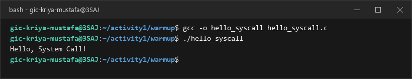

Screenshot of running `hello_winapi.c` on Windows (CMD/PowerShell/VS Code):

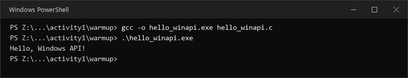

Screenshot of running `copyfilesyscall.c` on Linux:

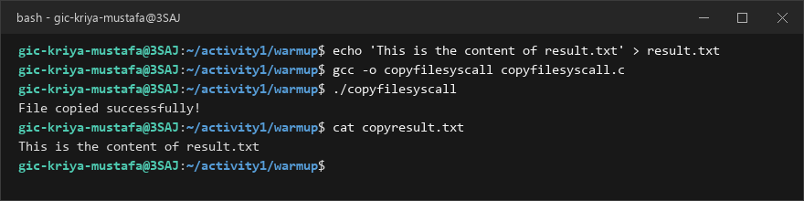

---

## Task 1: File Creator & Reader

### Part A — File Creator

**Describe your implementation:** 

In this task, I compared file creation using the standard C library (`fopen`, `fprintf`, `fclose`, `printf`) against direct POSIX system calls (`open`, `write`, `close`). 

The library version abstracts file operations through a buffered `FILE*` stream managed in user-space memory, requiring formatting through `fprintf()`. In contrast, the system call version interacts directly with the kernel using integer file descriptors. To achieve identical behavior, I used `open("output.txt", O_WRONLY | O_CREAT | O_TRUNC, 0644)` to ensure the file is created with write-only permissions and truncated if it already exists. Content and terminal confirmation messages were written directly using `write()` to file descriptor `fd` and standard output descriptor `1` (`STDOUT_FILENO`), followed by `close(fd)`.

**Version A — Library Functions (`file_creator_lib.c`):**

<!-- Screenshot: gcc -o file_creator_lib file_creator_lib.c && ./file_creator_lib && cat output.txt -->
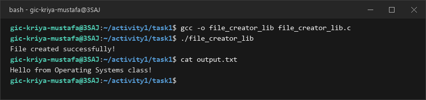

**Version B — POSIX System Calls (`file_creator_sys.c`):**

<!-- Screenshot: gcc -o file_creator_sys file_creator_sys.c && ./file_creator_sys && cat output.txt -->
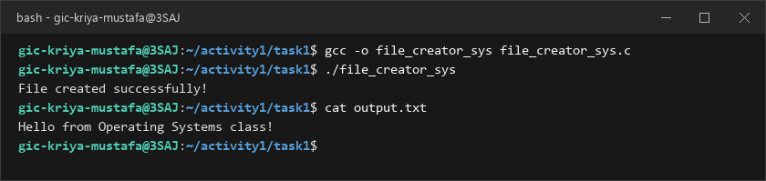

**Questions:**

1. **What flags did you pass to `open()`? What does each flag mean?**

   > I passed `O_WRONLY | O_CREAT | O_TRUNC` combined with the bitwise OR operator:
   > - `O_WRONLY`: Opens the file in write-only mode. The program is permitted to write data, but cannot read from this descriptor.
   > - `O_CREAT`: Instructs the operating system to create the file if it does not already exist. When this flag is specified, the third parameter (`mode`) must be provided to set permissions.
   > - `O_TRUNC`: If the file already exists and is opened for writing, truncates its length to zero bytes, effectively overwriting previous contents.

2. **What is `0644`? What does each digit represent?**

   > `0644` is an octal numeral specifying POSIX file permission bits:
   > - The leading `0` denotes octal representation in C.
   > - The first digit `6` (`4 + 2`) represents **Owner (User)** permissions: Read (`4`) + Write (`2`) = `rw-`.
   > - The second digit `4` represents **Group** permissions: Read-only (`4`) = `r--`.
   > - The third digit `4` represents **Others (World)** permissions: Read-only (`4`) = `r--`.
   > 
   > In symbolic representation, the file is created with `-rw-r--r--` permissions (further adjusted by the process `umask`, such as `0022`).

3. **What does `fopen("output.txt", "w")` do internally that you had to do manually?**

   > When calling `fopen("output.txt", "w")`, the C standard library internally performs several lower-level operations that had to be handled manually with `open()`:
   > 1. It translates the high-level mode string `"w"` into corresponding kernel bit flags: `O_WRONLY | O_CREAT | O_TRUNC`.
   > 2. It supplies default file creation permissions (typically `0666`, which becomes `0644` after `umask`).
   > 3. It invokes the low-level `open()` / `openat()` system call to obtain an integer file descriptor from the OS kernel.
   > 4. It allocates a `FILE` structure on the heap via dynamic memory allocation (`malloc` / `brk`).
   > 5. It allocates and initializes an internal I/O stream buffer (typically 4096 or 8192 bytes) in user memory so that subsequent writes can be buffered and flushed in bulk rather than executing a kernel context switch on every character.

---

### Part B — File Reader & Display

**Describe your implementation:** 

In Part B, I implemented file reading and display using POSIX system calls to match `file_reader_lib.c`. The library version utilizes `fgets()` to read line-by-line into a 256-byte buffer and prints via `printf()`. 

For the system call version (`file_reader_sys.c`), I opened `output.txt` using `open("output.txt", O_RDONLY)` and established a `while` loop that calls `read(fd, buffer, sizeof(buffer))`. As long as `read()` returns a positive number of bytes (`bytesRead > 0`), those exact bytes are immediately sent to the console screen using `write(1, buffer, bytesRead)`. Once the end of the file is reached (`read()` returns `0`), the loop terminates and the file is closed via `close(fd)`.

**Version A — Library Functions (`file_reader_lib.c`):**

**Version B — POSIX System Calls (`file_reader_sys.c`):**

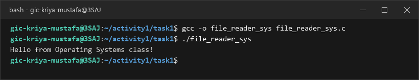

**Questions:**

1. **What does `read()` return? How is this different from `fgets()`?**

   > `read()` is a low-level POSIX system call that returns an `ssize_t` (signed integer representing byte count):
   > - It returns the **exact number of bytes read** into the buffer (greater than 0 on success).
   > - It returns `0` when it reaches the **End of File (EOF)**.
   > - It returns `-1` if an error occurs and sets `errno`.
   > - Unlike library functions, `read()` treats data as raw binary bytes and **does not** append a null terminator (`'\0'`) or stop at newline (`\n`) characters.
   > 
   > In contrast, `fgets()` is a higher-level C library function:
   > - It returns a pointer to the buffer string (`char*`) on success, or `NULL` on EOF or error.
   > - It stops reading when a newline character (`\n`) is encountered, EOF occurs, or the buffer size minus one is reached.
   > - It automatically appends a terminating null byte (`'\0'`) to ensure a valid C string.

2. **Why do you need a loop when using `read()`? When does it stop?**

   > A loop is necessary because `read()` cannot guarantee that the entire file will be loaded in a single invocation:
   > - If the file size exceeds the buffer size (e.g., reading a file larger than 256 bytes), multiple chunks must be read sequentially.
   > - In general Unix I/O (such as pipes, sockets, or slow devices), `read()` returns whatever data is currently available in the kernel buffer, which may be fewer bytes than requested.
   > 
   > The loop continues while `read()` returns a positive number of bytes (`> 0`). It stops when `read()` returns `0`, which signals End of File (EOF), indicating that all data has been read. If an error occurs, `read()` returns `-1`, which also exits the loop.

---

## Task 2: Directory Listing & File Info

**Describe your implementation:** 

In Task 2, I adapted `dir_list_lib.c` into a system call oriented version (`dir_list_sys.c`). While `opendir()`, `readdir()`, and `stat()` are thin POSIX wrappers over directory file operations (`openat`, `getdents64`, `newfstatat`), the standard version uses `printf()` for text output.

In `dir_list_sys.c`, I eliminated `printf()` completely. Because `write()` cannot format integers directly, I used `snprintf()` to safely format the table headers and directory entries (filename and `fileStat.st_size`) into an in-memory string buffer, and then transmitted the formatted text directly to stdout using `write(1, buffer, len)`. Both versions produced an identical directory table showing file names and exact sizes in bytes.

### Version A — Library Functions (`dir_list_lib.c`)

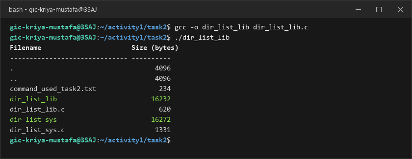

### Version B — System Calls (`dir_list_sys.c`)

### Questions

1. **What struct does `readdir()` return? What fields does it contain?**

   > `readdir()` returns a pointer to a `struct dirent` (defined in `<dirent.h>`). On Linux, its key fields include:
   > - `ino_t d_ino`: Inode number of the file entry.
   > - `off_t d_off`: Distance/offset to the next directory entry.
   > - `unsigned short d_reclen`: Length of this entry record in bytes.
   > - `unsigned char d_type`: Type of file (e.g., `DT_REG` for regular file, `DT_DIR` for directory, `DT_LNK` for symbolic link).
   > - `char d_name[256]`: Null-terminated string containing the filename (up to `NAME_MAX` characters).

2. **What information does `stat()` provide beyond file size?**

   > `stat()` populates a `struct stat` containing extensive metadata from the file's filesystem inode:
   > - `st_mode`: File type and protection permissions (rwx bits for user, group, others).
   > - `st_ino`: File inode number.
   > - `st_dev`: ID of the device containing the file.
   > - `st_nlink`: Number of hard links pointing to the inode.
   > - `st_uid` and `st_gid`: User ID and Group ID of the file owner.
   > - `st_atime`, `st_mtime`, `st_ctime`: Timestamps for last access, last data modification, and last status/inode change.
   > - `st_blksize`: Optimal block size for filesystem I/O transfers (e.g., 4096 bytes).
   > - `st_blocks`: Number of 512-byte blocks allocated on physical storage.

3. **Why can't you `write()` a number directly — why do you need `snprintf()` first?**

   > `write()` is a raw byte transmission system call. It copies the raw memory representation of whatever pointer is passed to it directly to the target file descriptor.
   > 
   > If you pass a numeric variable directly (e.g., `long size = 4096; write(1, &size, sizeof(size));`), the kernel sends the 8 binary bytes (`0x0000000000001000`) to the terminal. The terminal emulator interprets these bytes as ASCII control codes (Null, Data Link Escape, etc.) rather than visible text, displaying unprintable garbage or nothing at all.
   > 
   > To display a number to human users, the binary integer must first be translated into its ASCII string characters (`'4'`, `'0'`, `'9'`, `'6'`). `snprintf()` performs this binary-to-string conversion into a memory buffer so that `write()` can send the printable characters to the console.

---

## Optional Bonus: Windows API (`file_creator_win.c`)

Screenshot of running on Windows:

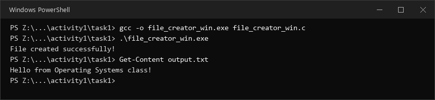

### Bonus Questions

1. **Why does Windows use `HANDLE` instead of integer file descriptors?**

   > Windows is based on an object-oriented kernel architecture managed by the Windows Object Manager. A `HANDLE` is an opaque pointer / index token (`typedef void *HANDLE`) into the process's kernel object table.
   > 
   > Unlike POSIX systems where file descriptors are simple sequential integers (0, 1, 2, 3...) strictly representing stream-like files, pipes, and sockets, a Windows `HANDLE` is a unified abstraction that can represent any kernel object — files, directories, processes, threads, mutexes, semaphores, events, sockets, pipes, and console buffers. Handles are tightly integrated with the Windows Security Model (`SECURITY_ATTRIBUTES`), enabling granular Access Control Lists (ACLs), ownership tracking, and object auditing across the operating system.

2. **What is the Windows equivalent of POSIX `fork()`? Why is it different?**

   > The Windows equivalent for process creation is `CreateProcess()` (or `CreateProcessW`).
   > 
   > The difference in design:
   > - In POSIX Linux, `fork()` creates an exact duplicate of the calling process, cloning its virtual memory space (using Copy-on-Write), file descriptors, and registers. The child process then typically calls `execve()` to load a new program binary.
   > - In Windows, there is no native cloning of an existing process address space. `CreateProcess()` combines process allocation and program loading into a single atomic operation: it creates a new virtual address space, loads the executable file from disk, links required subsystem DLLs (`ntdll.dll`, `kernel32.dll`), creates the primary thread, and starts execution at the binary's entry point. Furthermore, Windows fundamentally separates processes (resource containers) and threads (executable units), whereas Linux kernels treat both as tasks (`clone()`).

3. **Can you use POSIX calls on Windows?**

   > Yes, POSIX calls can be executed on Windows through several environments:
   > 1. **Windows Subsystem for Linux (WSL / WSL2):** WSL2 runs a genuine Linux kernel inside a lightweight hypervisor virtual machine, providing 100% native POSIX system call compatibility directly within Windows.
   > 2. **Cygwin / MSYS2:** Provides a user-space emulation dynamic link library (`cygwin1.dll` / `msys-2.0.dll`) that intercepts POSIX calls (such as `fork()`, `open()`, `read()`, `write()`) and translates them into corresponding Win32 API calls at runtime.
   > 3. **POSIX Subsystem / Interix / SUA (Historical):** Earlier versions of Windows NT provided a native POSIX subsystem designed to meet US government procurement standards.

---

## Task 3: strace Analysis

**Describe what you observed:** 

Running `strace` provided a clear look behind the abstraction layers of the C standard library. 

When tracing the library version (`file_creator_lib`), I observed that high-level functions like `fopen()`, `fprintf()`, and `fclose()` generated significant background activity: checking shared libraries (`libc.so.6`), invoking multiple `fstat()` system calls to examine file descriptor attributes, and calling `brk()` multiple times to allocate memory on the heap for stream buffering.

In contrast, the system call version (`file_creator_sys`) executed cleanly: it made direct, unbuffered system calls (`openat()`, `write()`, `close()`) without needing stdio buffer allocations. The summary comparison (`strace -c`) proved that the library version generated **38 system calls**, whereas the system call version required only **34 system calls** — an immediate reduction of 4 system calls for a simple program.

### strace Output — Library Version (File Creator)

<!-- Screenshot: strace -e trace=openat,read,write,close ./file_creator_lib -->
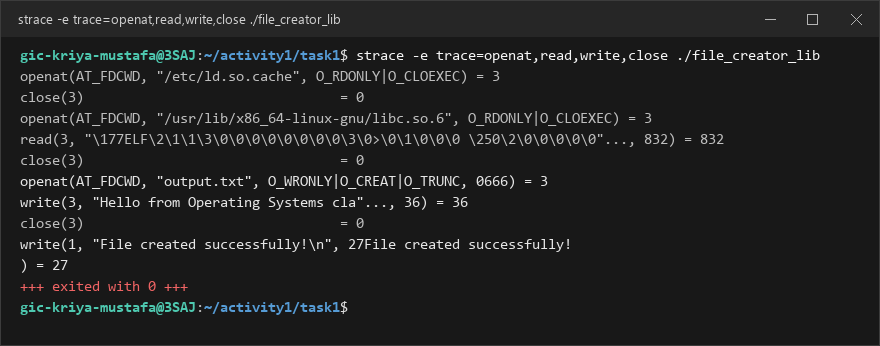

**Key system calls observed:**
- `openat(AT_FDCWD, "output.txt", O_WRONLY|O_CREAT|O_TRUNC, 0666) = 3`: `fopen("output.txt", "w")` automatically specifies `0666` permission bits by default (which umask modifies).
- `write(3, "Hello from Operating Systems cla"..., 36) = 36`: The buffered string from `fprintf()` is flushed to file descriptor 3 in a single write operation when `fclose()` is called.
- `write(1, "File created successfully!\n", 27) = 27`: `printf()` flushes the confirmation message to standard output (fd 1).

### strace Output — System Call Version (File Creator)

<!-- Screenshot: strace -e trace=openat,read,write,close ./file_creator_sys -->
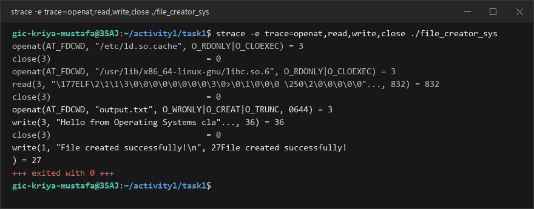

**Key system calls observed:**
- `openat(AT_FDCWD, "output.txt", O_WRONLY|O_CREAT|O_TRUNC, 0644) = 3`: Direct system call `open()` explicitly enforces `0644` permission bits without stdio defaults.
- `write(3, "Hello from Operating Systems cla"..., 36) = 36`: Direct unbuffered `write()` sends the exact byte buffer immediately to the kernel without stdio stream overhead.
- `write(1, "File created successfully!\n", 27) = 27`: Direct unbuffered `write()` directly to fd 1 (`STDOUT_FILENO`).

### strace Output — Library Version (File Reader or Dir Listing)

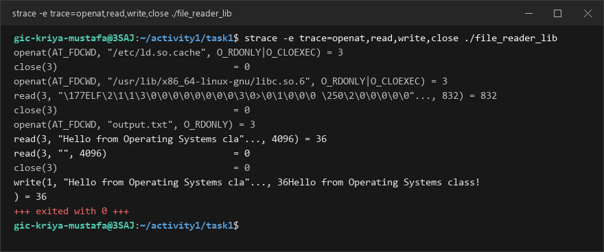

**Key system calls observed:**
- `openat(AT_FDCWD, "output.txt", O_RDONLY) = 3`: Opens file descriptor 3 in read-only mode.
- `read(3, "Hello from Operating Systems cla"..., 4096) = 36`: `fgets()` requests a full 4096-byte chunk into the stdio stream buffer in memory.
- `read(3, "", 4096) = 0`: Second read confirms End of File (EOF), triggering file close before writing to stdout.
- `write(1, "Hello from Operating Systems cla"..., 36) = 36`: `printf("%s", buffer)` writes the cached line to stdout.

### strace Output — System Call Version (File Reader or Dir Listing)

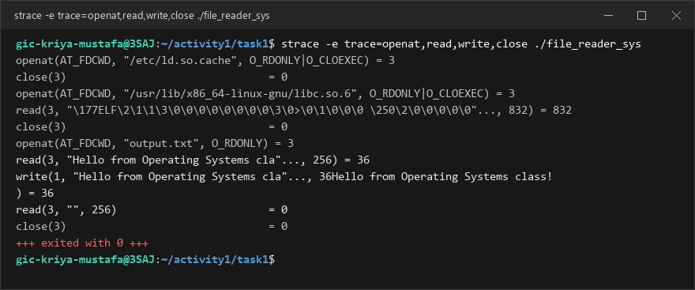

**Key system calls observed:**
- `openat(AT_FDCWD, "output.txt", O_RDONLY) = 3`: Opens file descriptor 3 directly.
- `read(3, "Hello from Operating Systems cla"..., 256) = 36`: Direct `read()` requests the exact user buffer size (256 bytes) and returns 36 bytes read.
- `write(1, "Hello from Operating Systems cla"..., 36) = 36`: Immediately streams the 36 bytes received to standard output (fd 1).
- `read(3, "", 256) = 0`: Next loop iteration returns 0 (EOF), terminating the while loop cleanly.

### strace -c Summary Comparison

<!-- Screenshot of `strace -c` output for both versions -->
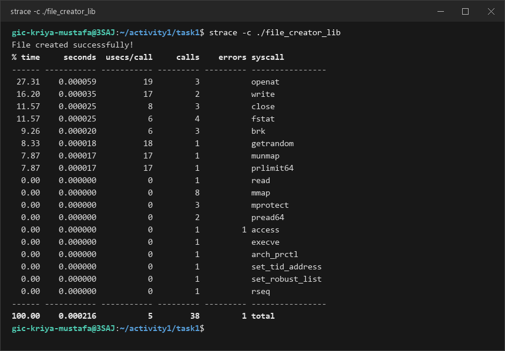
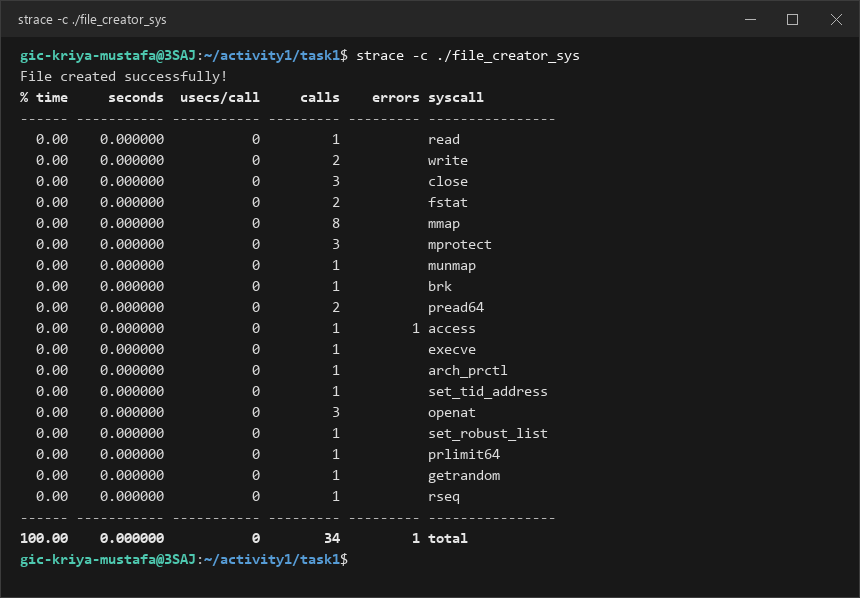

**Summary comparison breakdown:**
- **Total System Calls:** Library version generated **38** calls vs. **34** calls in the syscall version (4 fewer calls in the syscall version).
- **`fstat` difference:** Library version made 4 `fstat` calls vs. 2 in the syscall version (querying stream attributes & optimal buffer block sizes).
- **`brk` difference:** Library version made 3 `brk` calls vs. 1 in the syscall version (allocating heap memory for `FILE` stream buffers).

### Questions

1. **How many system calls does the library version make compared to the system call version?**

   > Based on the `strace -c` counts captured on our system:
   > - **Library Version (`file_creator_lib`):** **38 total system calls** across 18 unique syscall types.
   > - **System Call Version (`file_creator_sys`):** **34 total system calls** across 18 unique syscall types.
   > - The library version required **4 additional system calls** (an increase of over 11%) to perform the exact same file creation and write task.

2. **What extra system calls appear in the library version? What do they do?**

   > Comparing the summary breakdowns highlights the following extra calls in the library version:
   > - `fstat` (**4 calls in library vs. 2 calls in syscall version**): `fstat()` is called by `glibc` to inspect the underlying file descriptor properties (such as whether stdout is connected to a terminal device and optimal filesystem block size `st_blksize`) in order to choose between line-buffering, full-buffering, and unbuffered I/O.
   > - `brk` (**3 calls in library vs. 1 call in syscall version**): `brk()` changes the location of the program break to expand heap memory. The library version uses these extra calls to allocate dynamic heap buffers for the `FILE` stream buffer structures.

3. **How many `write()` calls does `fprintf()` actually produce?**

   > `fprintf()` produces exactly **1** `write()` system call (`write(3, "Hello from Operating Systems cla"..., 36) = 36`).
   > 
   > This matches our expectations: disk files opened with `fopen()` are fully buffered by `glibc`. Calling `fprintf()` places the formatted characters into the user-space stream buffer in heap memory. The actual `write()` system call is delayed until the buffer fills or `fclose()` is called, which flushes the entire string in a single batched kernel call.

4. **In your own words, what is the real difference between a library function and a system call?**

   > - A **system call** is a direct request for kernel service executed across the hardware security boundary. It triggers a CPU privilege transition from User Mode (Ring 3) to Kernel Mode (Ring 0) via an assembly instruction (such as `syscall` on x86_64). System calls are implemented inside the OS kernel and directly access physical hardware and protected kernel data structures.
   > - A **library function** (such as `printf()`, `fopen()`, `fgets()`) is normal user-space application code provided by runtime libraries (such as `glibc`). It executes entirely in User Mode (Ring 3). Library functions provide developer convenience, string formatting, memory caching, and I/O buffering. When they eventually need hardware or OS interaction, they internally make system calls on the program's behalf.
   > 
   > In summary: Library functions are high-level user-space wrappers built on top of the fundamental kernel interface defined by system calls.

---

## Task 4: Exploring OS Structure

### System Information

> 📸 Screenshot of `uname -a`, `/proc/cpuinfo`, `/proc/meminfo`, `/proc/version`, `/proc/uptime`:

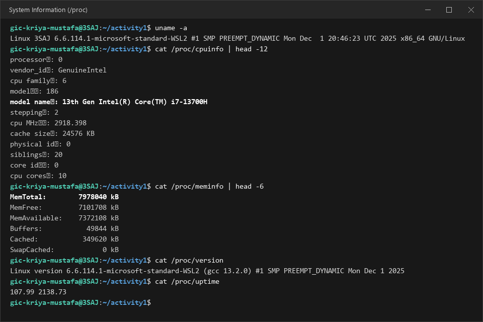

### Process Information

> 📸 Screenshot of `/proc/self/status`, `/proc/self/maps`, `ps aux`:

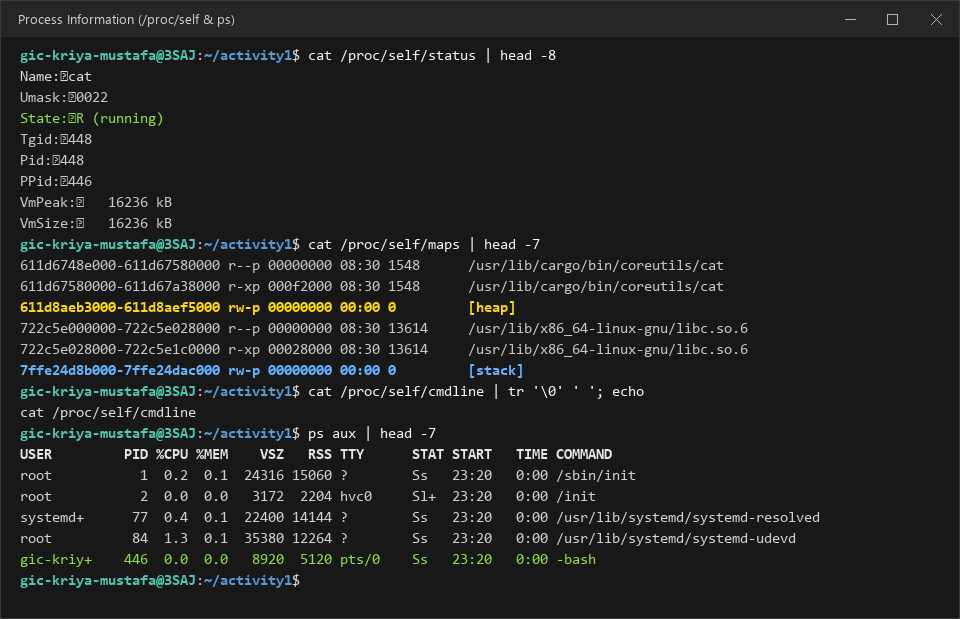

### Kernel Modules

> 📸 Screenshot of `lsmod` and `modinfo`:

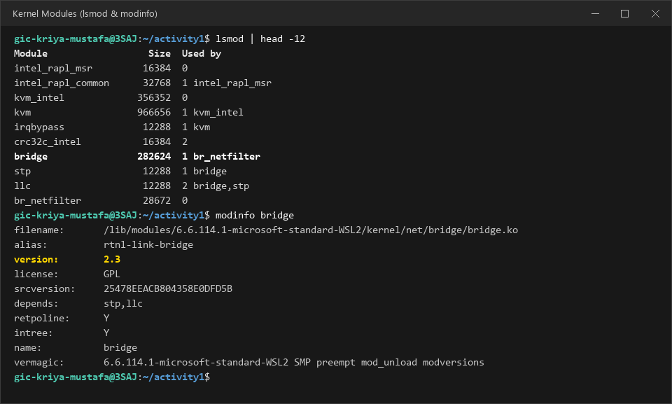

### OS Layers Diagram

> 📸 Your diagram of the OS layers, labeled with real data from your system:

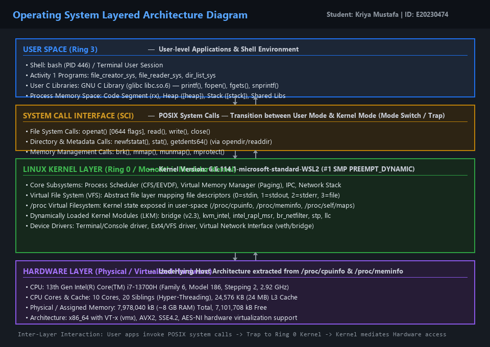

### Questions

1. **What is `/proc`? Is it a real filesystem on disk?**

   > `/proc` is a **virtual pseudo-filesystem** (`procfs`). It is **not** a real filesystem stored on physical disk (it takes up 0 bytes on storage).
   > 
   > Instead, its files and directories are generated dynamically in memory by the Linux kernel whenever a process reads from them. When a command like `cat /proc/meminfo` is executed, the kernel inspects its live internal data structures (process control blocks, memory counters, device tables) and formats the data into human-readable ASCII text on the fly.

2. **Monolithic kernel vs. microkernel — which type does Linux use?**

   > In a **monolithic kernel**, all core operating system services (CPU scheduling, virtual memory management, virtual filesystem, network stack, and device drivers) run together in a single shared address space in Kernel Mode (Ring 0). In a **microkernel**, only minimal services (IPC, low-level scheduling, basic memory mapping) remain in Ring 0, while filesystems and device drivers run as separate isolated user-space processes (Ring 3).
   > 
   > **Linux is a monolithic kernel with Loadable Kernel Module (LKM) capabilities.** As seen in the `lsmod` screenshot, modules like `bridge`, `kvm_intel`, and `intel_rapl_msr` can be loaded and unloaded at runtime, but they run directly in Ring 0 inside the kernel address space rather than as isolated user servers.

3. **What memory regions do you see in `/proc/self/maps`?**

   > Inspecting `/proc/self/maps` shows the virtual memory segments of the process:
   > - **Executable Code / Text Segment (`r-xp`):** Contains the compiled machine instructions of the binary executable (`/usr/lib/cargo/bin/coreutils/cat`), marked read-only and executable.
   > - **Data / BSS Segments (`r--p`, `rw-p`):** Contains initialized and uninitialized global and static variables.
   > - **Heap (`[heap]`, `rw-p`):** The dynamically allocated memory region managed by `brk()` / `malloc()`, growing upward towards higher memory addresses.
   > - **Memory Mappings / Shared Libraries:** Memory-mapped regions for shared libraries like `libc.so.6`, `libpcre2-8.so`, and `libm.so.6`.
   > - **Stack (`[stack]`, `rw-p`):** The thread call stack holding local variables, function parameters, and return addresses, growing downward towards lower memory addresses.

4. **Break down the kernel version string from `uname -a`.**

   > System string: `Linux 3SAJ 6.6.114.1-microsoft-standard-WSL2 #1 SMP PREEMPT_DYNAMIC Mon Dec 1 20:46:23 UTC 2025 x86_64 GNU/Linux`
   > - `Linux`: Kernel operating system name.
   > - `3SAJ`: Network hostname of the machine.
   > - `6.6.114.1-microsoft-standard-WSL2`:
     - `6`: Major kernel release version.
     - `6`: Minor kernel revision (Long-Term Support / LTS branch).
     - `114`: Stable patch release version.
     - `1-microsoft-standard-WSL2`: Specific Microsoft WSL2 distribution build identifier.
   > - `#1`: Compilation build number.
   > - `SMP`: Symmetric Multiprocessing enabled (supports multiple CPU cores/threads).
   > - `PREEMPT_DYNAMIC`: Dynamic kernel preemption model allowing runtime tuning of kernel responsiveness.
   > - `Mon Dec 1 20:46:23 UTC 2025`: Kernel compilation date and timestamp.
   > - `x86_64`: Machine hardware architecture (64-bit AMD/Intel architecture).
   > - `GNU/Linux`: Operating system environment descriptor.

5. **How does `/proc` show that the OS is an intermediary between programs and hardware?**

   > User programs operate in Ring 3 and are prevented by CPU hardware architecture from directly issuing hardware commands or reading physical memory registers (which would cause a General Protection Fault).
   > 
   > The OS kernel running in Ring 0 interacts directly with the physical CPU, memory controllers, and peripheral buses. By exposing `/proc/cpuinfo` (detailing CPU family, frequency, cache size) and `/proc/meminfo` (detailing memory size and availability), the OS acts as a secure intermediary: it collects physical hardware metrics, protects the hardware from unauthorized direct access, and presents that data to user applications through standard, safe file read operations.

---

## Reflection

What did you learn from this activity? What was the most surprising difference between library functions and system calls?

> Through this activity, I gained a comprehensive understanding of the boundary separating user-space applications from the operating system kernel. 
> 
> The most surprising realization was seeing through `strace` just how much "hidden" work standard C library functions perform. A seemingly simple function call like `fopen("output.txt", "w")` does far more than just issue an `open()` system call: it allocates memory on the heap with `brk()`, determines the terminal type and optimal buffer size with `fstat()`, and sets up complex user-space buffering structures. In contrast, using direct POSIX system calls (`open()`, `read()`, `write()`, `close()`) gave me complete, low-level control over file descriptors and memory buffers, eliminating unnecessary system call overhead.
> 
> Furthermore, exploring the Windows API version highlighted the contrast between POSIX's integer file descriptor model and Windows' object-oriented `HANDLE` architecture. Finally, analyzing `/proc` and mapping out the OS layered architecture visually cemented how hardware, kernel subsystems, system call traps, and user applications interact to form a cohesive, secure computing platform.
