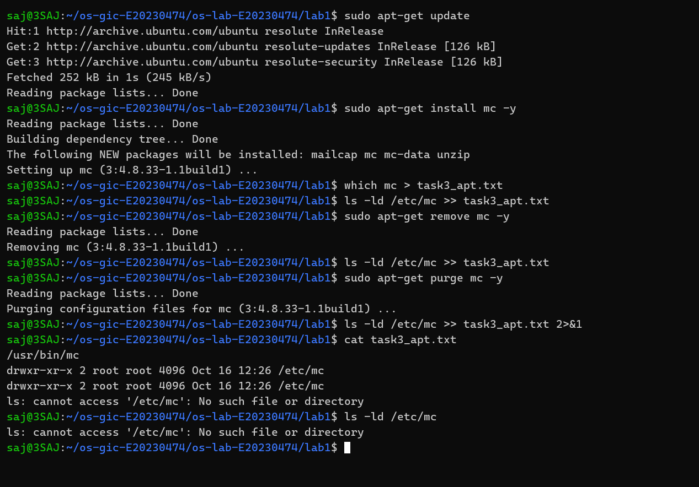
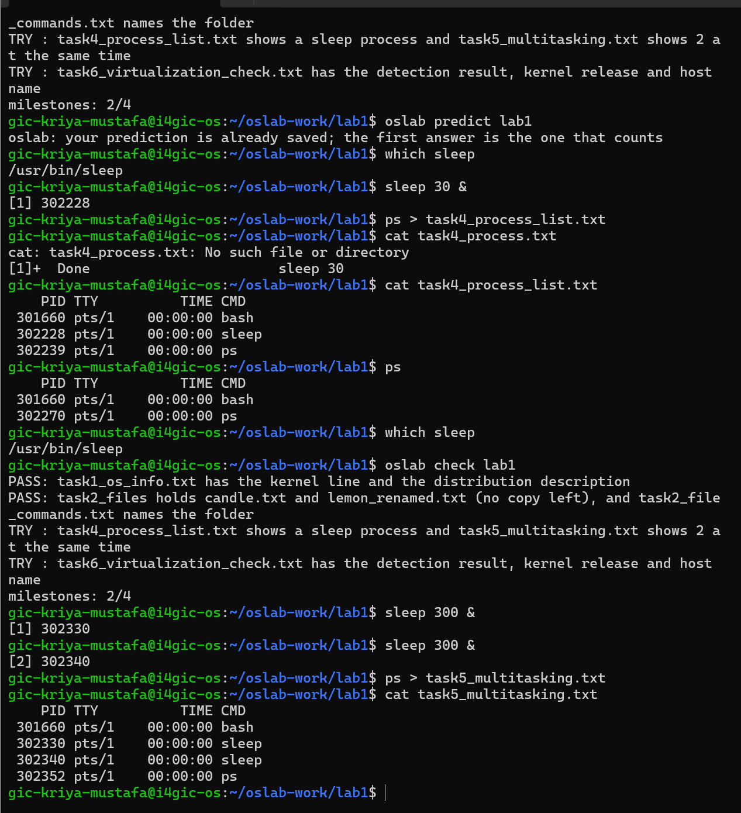
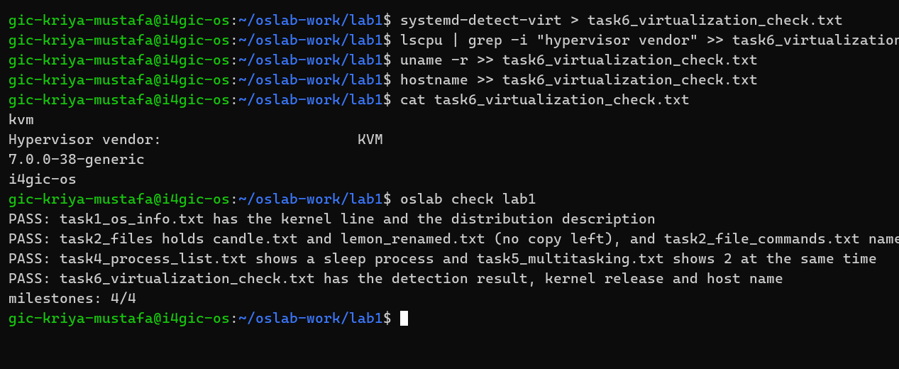

# OS Lab 1 Submission

- **Student Name:** Kriya Mustafa
- **Student ID:** E20230474
- **Ubuntu username on the server:** `gic-kriya-mustafa`
- **My values** (`oslab values lab1`): `file1 = candle`, `file2 = lemon`, `count = 2`

---

## Task 1: Operating System Identification

During this task, I identified the kernel version and distribution details of the course server.

```text
Linux i4gic-os 7.0.0-38-generic #38-Ubuntu SMP PREEMPT_DYNAMIC Fri Sep  4 09:10:14 UTC 2026 x86_64 GNU/Linux
Distributor ID:	Ubuntu
Description:	Ubuntu 26.04.1 LTS
Release:	26.04
Codename:	resolute
```

- **Kernel version:** `7.0.0-38-generic` (obtained from `uname -a`).
- **Distribution version:** Ubuntu `26.04.1 LTS` (Release `26.04`, Codename `resolute`, obtained from `lsb_release -a`).

**Difference between Kernel and Distribution:**
The kernel is the foundational core of the operating system that directly controls and abstracts computer hardware (managing CPU scheduling, virtual memory, device drivers, and system calls). The distribution (Ubuntu 26.04.1 LTS) is the complete operating environment constructed on top of the Linux kernel, packaging system libraries (glibc), standard GNU coreutils, shells (bash), system services (systemd), and the APT package management ecosystem.

---

## Task 2: Essential Linux File and Directory Commands

I navigated the filesystem and performed essential file management operations:
1. Created a subfolder `task2_files` using `mkdir` and entered it with `cd`.
2. Recorded current working directory with `pwd` (`/home/gic-kriya-mustafa/oslab-work/lab1/task2_files`).
3. Created two personal files `candle.txt` and `lemon.txt` with `touch`.
4. Populated each file with sample text using `echo` and redirection `>`. Verified with `cat`.
5. Created a duplicate `candle_copy.txt` using `cp`.
6. Renamed `lemon.txt` to `lemon_renamed.txt` using `mv`.
7. Deleted `candle_copy.txt` using `rm`.

The final `ls` command in the working directory showed:
`candle.txt` and `lemon_renamed.txt`.

Contents of `task2_file_commands.txt`:
```text
/home/gic-kriya-mustafa/oslab-work/lab1/task2_files
candle.txt
lemon_renamed.txt
candle.txt
lemon.txt
lemon_renamed.txt
This is file candle
This is file lemon
candle.txt
lemon_renamed.txt
candle.txt
lemon_renamed.txt
```

---

## Task 3: Package Management Using APT

I tested installing, removing, and purging Midnight Commander (`mc`) on my local Ubuntu environment (WSL):

Contents of `task3_apt.txt`:
```text
/usr/bin/mc
drwxr-xr-x 2 root root 4096 Oct 16 12:26 /etc/mc
drwxr-xr-x 2 root root 4096 Oct 16 12:26 /etc/mc
ls: cannot access '/etc/mc': No such file or directory
```

**Difference observed between `remove` and `purge`:**
- `sudo apt-get remove mc -y` uninstalls the executable package files (removing `/usr/bin/mc`), but intentionally **preserves** the configuration files in `/etc/mc`. Running `ls -ld /etc/mc` confirmed the configuration directory remained on disk (`drwxr-xr-x`).
- `sudo apt-get purge mc -y` uninstalls the package **and removes all configuration files**. After purging, running `ls -ld /etc/mc` confirmed that `/etc/mc` was deleted (`ls: cannot access '/etc/mc': No such file or directory`).

<!-- SCREENSHOT REQUIREMENT: your terminal after the purge, showing `ls -ld /etc/mc` and your prompt. -->


---

## Task 4: Programs vs Processes

I investigated the distinction between an executable program on disk and an active process in execution:
- **Program:** A passive collection of instructions and binary data stored permanently on secondary storage (disk), e.g., `/usr/bin/sleep`.
- **Process:** An active, executing instance of a program loaded into main memory (RAM), assigned an isolated address space, execution context (registers, stack, program counter), and a unique Process ID (PID).

**Observations Before, During, and After:**
- **Before:** `which sleep` returned `/usr/bin/sleep`, proving the binary existed on disk. `ps` showed only `bash` and `ps`; no sleep process was executing.
- **During:** Running `sleep 30 &` launched the program as a background process with PID `302228`. `ps` listed `302228 pts/1 00:00:00 sleep` running concurrently alongside the shell.
- **After:** Once 30 seconds elapsed, the process completed and terminated. `ps` confirmed that PID `302228` no longer existed in memory. However, running `which sleep` confirmed that `/usr/bin/sleep` remained intact on disk.

---

## Task 5: Multitasking

Using my personal count value (`count = 2`), I launched 2 concurrent background instances:
```bash
sleep 300 &
sleep 300 &
```

Contents of `task5_multitasking.txt`:
```text
    PID TTY          TIME CMD
 301660 pts/1    00:00:00 bash
 302330 pts/1    00:00:00 sleep
 302340 pts/1    00:00:00 sleep
 302352 pts/1    00:00:00 ps
```

- **What this shows:** The operating system supports concurrency and multitasking. Multiple independent processes can be instantiated from a single static program binary, each receiving an independent PID (PID 302330 and PID 302340) and operating simultaneously.
- **What this does NOT show:** Because `sleep` suspends execution and puts the processes into a waiting state (`TASK_INTERRUPTIBLE`), it consumes virtually 0% CPU cycles. Consequently, it does not demonstrate how the operating system's CPU scheduler multiplexes processor cores, allocates time-slices, or balances active computational workloads across available CPUs.

<!-- SCREENSHOT REQUIREMENT: your terminal with the `ps` result and your prompt. -->


---

## Task 6: Virtualization and Hypervisor Detection

Based on the command outputs on the course server:
```text
kvm
Hypervisor vendor:                       KVM
7.0.0-38-generic
i4gic-os
```

- `systemd-detect-virt` returned `kvm`.
- `lscpu | grep -i "hypervisor vendor"` identified `KVM` (Kernel-based Virtual Machine).
- **Conclusion:** The course server is running inside a **virtual machine** powered by the **KVM** hypervisor, rather than directly on physical bare-metal hardware.

<!-- SCREENSHOT REQUIREMENT: your terminal with the output of the four commands and your prompt. -->


---

## My Prediction: Confirmed or Corrected

1. **Prediction 1 (Program file existence after process termination):**
   - **Result:** Confirmed.
   - **Evidence:** Running `which sleep` returned `/usr/bin/sleep` both before running `sleep 30 &` and after the background process had finished. Terminating a process does not alter the program file on disk.

2. **Prediction 2 (Multitasking multiple instances from one program):**
   - **Result:** Confirmed.
   - **Evidence:** Executing `sleep 300 &` twice created two distinct running processes with PIDs `302330` and `302340`, proving that multiple processes can run simultaneously from a single program.

3. **Prediction 3 (APT remove vs. purge behavior on /etc):**
   - **Result:** Confirmed.
   - **Evidence:** In Task 3, `sudo apt-get remove mc` left `/etc/mc` intact on disk, while `sudo apt-get purge mc` removed the `/etc/mc` directory completely (`ls: cannot access '/etc/mc': No such file or directory`).

---

## Plus / Challenge (only if you did them)

### Plus
- **Process count in `top`:** The `Tasks:` line in `top` lists far more processes than the ones I launched because a multi-user Linux system runs numerous background system daemons (e.g., `systemd` init, `journald`, `sshd`, `dbus`, `cron`) to maintain system operations, alongside processes initiated by other logged-in users.
- **Core count with `nproc`:** `nproc` shows the number of available CPU cores. Even with fewer CPU cores than running processes, the OS effortlessly handles numerous processes because sleeping processes yield the CPU, requiring no active core time.

### Challenge
- **`ps -e | wc -l` analysis:** Running `ps -e | wc -l` reveals hundreds of concurrent processes across the server.
- **Who started them:** The vast majority of these processes were spawned by the `systemd` init process (PID 1) during boot to manage background system services, networking, logging, and hardware interfaces. The remaining processes belong to interactive SSH sessions opened by other concurrent users on the shared server.

---

## AI Note (optional)

- **AI Suggestion:** When checking for configuration directory removal after `apt-get purge`, an AI suggested appending `2>&1` to `ls -ld /etc/mc >> task3_apt.txt 2>&1` so that error output (`stderr`) would be captured in the file instead of being printed only to the terminal.
- **Verification:** I tested this in Task 3 and verified that `task3_apt.txt` successfully recorded `ls: cannot access '/etc/mc': No such file or directory`.
